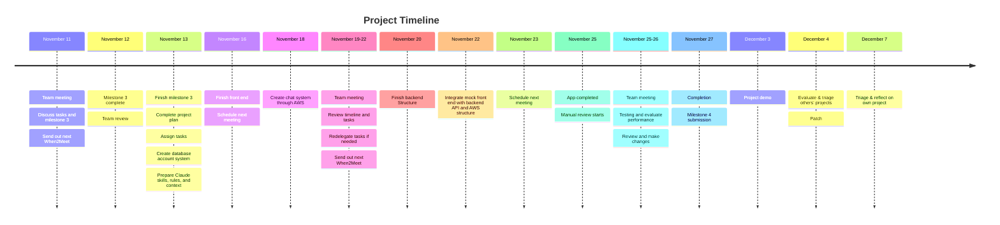

# Milestone 3 Submission

## 1. How will you coordinate your work?

The PM (Kevin) will coordinate task assignment and facilitate communication between different groups, including organizing meetings and reviewing task reassignments (if any were to occur).

The Lead Developer (Felix) will work with the other developers to coordinate tasks within the development team. The work assigned to each member will be reviewed by the PM. The Designer (Sarah) will work with the PM to check development and ensure requirements are met. The Designer will provide input in design decisions and clarify design ambiguities.

The PM will ensure project management strategies are used. Members will have a list of well-defined tasks (to-do list) and understand the scope of their work. Communication will be prioritized and code will be well-documented. Code will be reviewed by the PM and Designer before submission.

We will have meetings weekly on Discord (See timeline for more information). The PM will create agendas and record minutes, in the event that one member is absent. After each meeting, the PM will create action items and revise the delegation of tasks and timeline as needed. Members can request items to be added to the agenda prior to the meeting. Otherwise, meetings will mostly consist of updates and check-ins.

## 2. What tools will you use to communicate?

For messaging communication, we will be using Discord as our primary platform. We have been using Discord since Milestone 1, and it allows for calling/messaging for both desktop and mobile. Further, different text channels allow for organization of conversations. We considered Slack, Instagram, Teams and Zoom as alternatives. Slack was difficult to set-up, and some members were unfamiliar with the Teams UI. Zoom does not allow for messaging outside of meetings and has a call limit for free-plan users. Instagram does not allow for organization of several conversations taking place at the same time. However, if Discord is ever offline, we will be switching to Instagram, where a group chat is already established.

For programming, code will be shared using Github. Github is the industry standard for codesharing, and everyone is familiar with the application. We considered BitBucket as an alternative but none of us were familiar with how to use it.

## 3. Who will own component in your architecture?

### Backend Structural Components (Felix)

- **Database**
  - Credentials/Authentication/IAM
  - Chat logs
  - Profile information
- **Calculations**
  - Compatibility/Matches
- **Notification services**
  - Email
  - Push notifications
  - Sockets (maybe chat instances)

Note: Models are primarily backend functions, controllers are communicators between front and backend, and views are the UI of our app

### Component Ownership

- **AccountModel** - (Felix)
- **AccountController** - (Gavin & Felix)
  - Gavin is implementing, but coordinating with Felix for backend integration
- **LoginView** - (Gavin)
- **ProfileView** - (Gavin)
- **MusicTasteModel** - (Felix)
- **SongSuggestionModel** - (Felix)
- **SongController** - (Gavin & Yara & Felix)
  - Gavin and Yara are implementing, but coordinating with Felix for backend integration
- **HomeView** - (Gavin)
- **MatchModel** - (Felix & Gavin)
  - Gavin is implementing, but coordinating with Felix for backend integration
- **MatchView** - (Gavin)
- **ChatModel** - (Felix)
- **ChatController** - (Yara & Felix)
  - Yara is implementing, but coordinating with Felix for API integration
- **ChatView** - (Yara)
- **MessageLogView** - (Yara)
- **BottomBarView** - (Yara)
- **ViewController** - (Yara & Felix)
  - Yara is implementing, but coordinating with Felix for API integration

## 4. What is your timeline? Include a list of milestones you'll reach and deadlines for each.

### November 11
- **Team meeting**
  - Discuss tasks and milestone 3
  - Send out next When2Meet

### November 12
- Milestone 3 complete → team review

### November 13
- Finish milestone 3
  - Complete plan for the project
  - Assign tasks to each person
- Create database account system (IAM maybe?) + email verification (maybe phone number)
- Prepare all Claude skills, rules, and context to be used across all the devs

### November 16
- Finish front end (Views & Mock Output Controllers) with a mock database stored locally
- Schedule next meeting in accordance to when2meet

### November 18
- Create chat system through AWS

### November 19 - November 22 (depending on availability)
- **Team meeting**
  - Review timeline and ensure tasks are completed
  - Redelegate any tasks if needed
  - Send out next When2Meet

### November 20
- Finish backend Structure

### November 22
- Integrate mock front end with backend API and AWS structure

### November 23
- Schedule next meeting in accordance to when2meet

### November 25
- App completed → manual review starts

### November 25 - 26 (depending on availability)
- **Team meeting**
  - Testing and evaluate performance against requirements
  - Review and make any needed changes

### November 27
- Completion (Milestone 4 submission)

### December 3
- Project demo

### December 4
- Evaluate & triage others’ projects
  - Patch

### December 7
- Triage & reflect on own project

### Visual Timeline
(created on Mermaid Live Editor)

Note. In the event that it is unlikely that the final project will have all the original components due to a lack of time, the team will have an emergency meeting to determine which ideas to cut. If this were to happen, several areas, including crises, time commitment, grading, code coverage and feasibility, must be considered. 

## 5. How will you verify that you've met your requirements?

### ACCEPTABLE TESTING PLAN

### Visual Inspection Testing

The following requirements will be checked visually. No programming tests are needed and visual inspection will be done by the PM and Developer to ensure the requirement is met. We will be looking to see if the visual elements meet the requirements and the implementation makes logical sense to users.

- The font should be readable.
- One font should be used for the entire app.
- The background colour should contrast with UI elements.
- A navigation bar should be present when viewing the home, profile, and list of chats pages.
- The navigation bar should allow users to navigate to the home, profile, or list of chats page.
- The **Create a New Account** page should display terms of service text describing a policy against fake accounts.
- A song should be displayed on the homepage at all times.
- The album cover of the song should be in the middle of the home page.
- The playtime of the song should be displayed at the bottom of the home page, indicating how long the song has been playing.
- A pause button should be on the home page to pause the current song.
- A supporting coloured background should be displayed behind the album cover of the song, occupying the entire home page.
- A like button should be displayed directly underneath the album cover, near the play/pause button.
- By default, a song should play a sound preview when displayed on the home page.

### Black-Box Testing

The following requirements will be checked through black-box testing, whereby functionality of the implementation is verified through what is outputted from user input. No programming tests are needed.

- The **Create a New Account** page should prompt the user for a username/email and password.
- The **Create a New Account** page should ask the user to verify the password entered.
- Users should be able to log in to a pre-existing account by inputting the correct login credentials on the login screen.
- Users without a pre-existing account should be able to create a new account using the **Create a New Account** page.
- The login page should prompt the user for a username/email and password.
- The login page should display an error message if the login credentials don't match an existing profile.
- The login page should redirect to the user's homepage if the credentials match an existing profile.
- The **Create a New Account** page should create a blank account matching the input credentials.
- The home page should have access to a library of songs.
- Pressing the play button should resume the song from the timestamp at which it was paused.
- Users should be able to swipe left to skip the song preview.
- Upon skipping, the home page should generate a preview of a new song from the song library.
- A play button should replace the pause button when a song is paused.
- Users should be able to swipe right to listen to the full song.
- The matching algorithm should present the match to both matched users.
- When a match is presented, the user should be given the option to accept or reject it.
- The matching algorithm should create a chat interface between matched users if both users accept the match.
- When a new account is created, a verification link should be sent to the inputted email address.
- When the new account link is clicked from the email, the user's account is verified.
- If the new account link from the email is not clicked, the user's new account cannot be accessed.
- When a user clicks into a chat from the list of chats page, the specific contents of that chat should be fetched.
- Chats on the list of chats page should be ordered by the time the last message was most recently sent or received, with chats with more recent activity at the top.
- When a chat is opened, the username of the profile the user is communicating with should be displayed at the top of the chat.
- When a chat is opened, a back button should be displayed to the left of the other profile's username.
- The back button within a chat should redirect the user to the list of chats page.
- When a chat is opened, a green dot should be displayed next to the username if the other user is online.
- When a chat is opened, messages from the other user should be left-aligned.
- When a chat is opened, messages from the other user should have a blue background overlay.
- When a chat is opened, the other user's profile picture should be displayed next to each set of messages sent within one minute.
- When a chat is opened, messages from the user should be right-aligned.
- When a chat is opened, messages from the user should have a blue background overlay.
- When a chat is opened, a rectangle with rounded edges (text bar) at the bottom of the screen should allow the user to input text.
- When a chat is opened, a button to the right of the text bar should allow users to send the inputted text.
- When a chat is opened, a report button should be displayed to the right of the other profile's username.
- When a user presses the report button, the chat should disappear from their list of chats.
- When a user presses the report button, the system should flag the reported chat.

### White-Box Testing

The following requirements will be verified by a test suite written by the developers with Claude assistance to ensure that our implementation is well-structured and logically robust. We will be using Jacoco to ensure code-converge. The test suite should achieve at least 90% path coverage and 85% branch. All methods should be tested as well.

- The matching algorithm should hold a collection of predefined song tags.
- The login page should compare the user's identity to the list of profiles.
- A song should be given tags when added to the application.
- Song tags should always accompany a song in the matching algorithm.
- The matching algorithm should record the pattern of tags that the user prefers, based on their music preferences.
- The matching algorithm should be able to calculate a percentage from 0% to 100% indicating how much two users' tag patterns match.
- The matching algorithm should match a user with the next-highest match among users who have been active in the past 72 hours.
- If the user rejects the presented match, the matching algorithm should search for the next match found.

The requirements were sorted into Visual, Black-Box Testing and White-Box Testing.

Visual and Black-Box Testing will be done by the PM and Designer. White-Box Testing will be done with tests written by Claude, overseen by Developers. Upon request from any member of the team or as seen fit, a requirement’s test can be elevated in the following order: Visual → Black-Box Testing → White-Box Testing. When grouping tasks into these categories, in cases of disagreement, the test was placed into the higher category. For this reason, although some of the tests may be completed with a lower level of testing, going through a higher level of testing will ensure the requirement is properly met.

Since both the PM and Designer are avaiable for Visual and Black-Box Testing while there will be three Developers for White-Box testing, the plan is resilent to crises. 

### Additional

#### If you conduct a review or inspection, what aspects of the code will you inspect to verify the requirement is met?

1. Detailed specifications are written for each method
2. Abstract functions and rep invariants are implemented as appropriate for ADTs
3. Follows good language conventions and practices
4. All variables contained within proper scope
5. Avoids memory leaks
6. Encrypts and protects sensitive user data and information
7. Mutability/immutability of objects, variables follow specifications

#### For all of the requirements, how will your verifications be integrated into your process?

Will you run automated tests after every build? Before every commit? When will you conduct inspections, and who will be involved?

1. We will run all our tests after every build - white box testing will be done under discretion of developers, in junction with every build
2. Visual inspection and black-box testing will be done through a live user demo during a team meeting after all implementations are complete. Designer will lead this mini demo session and check with developers to ensure everyone is on the same page.
3. Commits will be made regularly with brief descriptions to Github
